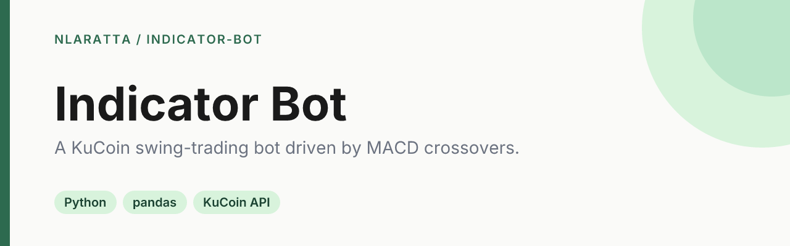

<p align="center">
  
</p>

<p align="center">
  <a href="https://github.com/nlaratta/indicator-bot/actions/workflows/ci.yml"></a>
  <a href="LICENSE"></a>
</p>

A swing trading bot for KuCoin that tries to catch short-term reversals using the MACD indicator. It starts in dry-run mode: it reads public candles, computes signals and logs what it would buy or sell, with no orders and no API keys.

> **Risk disclaimer.** This is a hobby project, not financial advice. Crypto trading can lose you money fast, and the strategy is a simple foundation with no guarantee of profit. Use it at your own risk, and run it in `DRY_RUN` first. The author is not responsible for any losses.

## Quick start

Needs Python 3.12 or newer.

With [uv](https://docs.astral.sh/uv/):

```bash
git clone https://github.com/nlaratta/indicator-bot.git
cd indicator-bot
uv venv
uv pip install -r requirements.txt
uv run python main.py --once   # one dry-run iteration, then exit
uv run python main.py          # keep running (Ctrl+C to stop)
```

With plain venv and pip:

```bash
git clone https://github.com/nlaratta/indicator-bot.git
cd indicator-bot
python3 -m venv .venv
source .venv/bin/activate
pip install -r requirements.txt
python main.py --once
```

Run the tests with `pip install -r requirements-dev.txt && pytest`.

## Configuration

Copy `.env.example` to `.env` (git-ignored). All settings are environment variables:

| Variable | Default | Meaning |
| --- | --- | --- |
| `DRY_RUN` | `1` | `1` logs signals only. `0` places real market orders. |
| `KUCOIN_API_KEY`, `KUCOIN_API_SECRET`, `KUCOIN_API_PASSPHRASE` | empty | Required only when `DRY_RUN=0`. [How to create an API key](https://support.kucoin.plus/hc/en-us/articles/360015102174-How-to-Create-an-API-). |
| `SYMBOL` | `BTC-USDT` | Trading pair. |
| `FUNDS` | `10` | USDT value of each order. |
| `PERIOD` | `5min` | Candle size (`1min` up to `1week`). |
| `FEE` | `0.001` | Your fee rate (`0.001` = 0.1%). |
| `POLL_SECONDS` | `1` | Delay between polls. |

Live trading refuses to start unless `DRY_RUN=0` and all three credentials are set.

## How it works

- Sells when the MACD histogram crosses below zero and price is more than 0.4% above the last buy price.
- Buys when the MACD histogram crosses above zero.
- Also buys if price falls more than 2% below the last sale.
- The bot assumes you already hold the asset when it starts, so its first move is a sell (without the gain check, since the buy price is unknown).
- The signal logic is a pure function in `strategy.py`, covered by tests that use synthetic price series.

## Project structure

- `main.py` fetches KuCoin candles and runs the loop (or logs, in dry run).
- `strategy.py` holds the pure `decide()` signal function.
- `config.py` reads settings from the environment and `.env`.
- `tests/` has the pytest suite (no network).

## License

[MIT](LICENSE) © Noah Laratta
